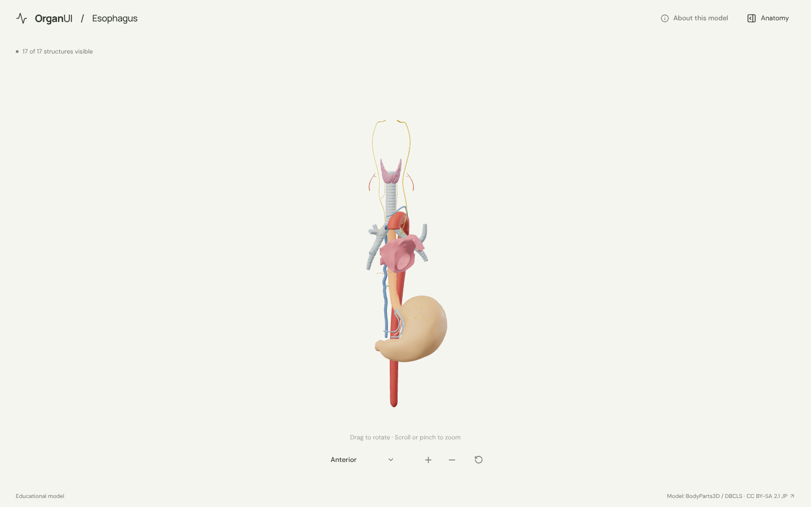
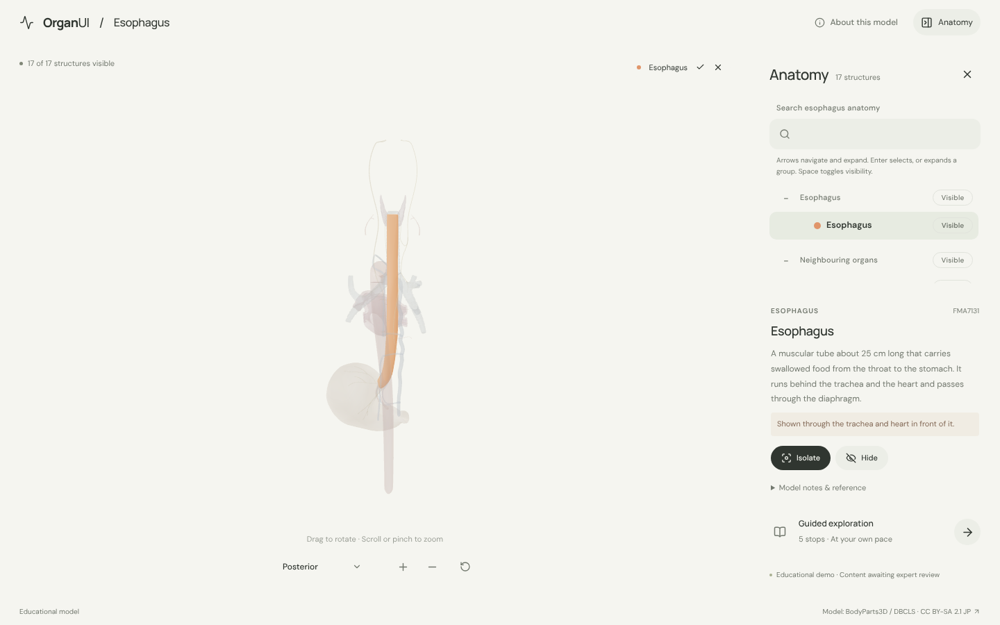
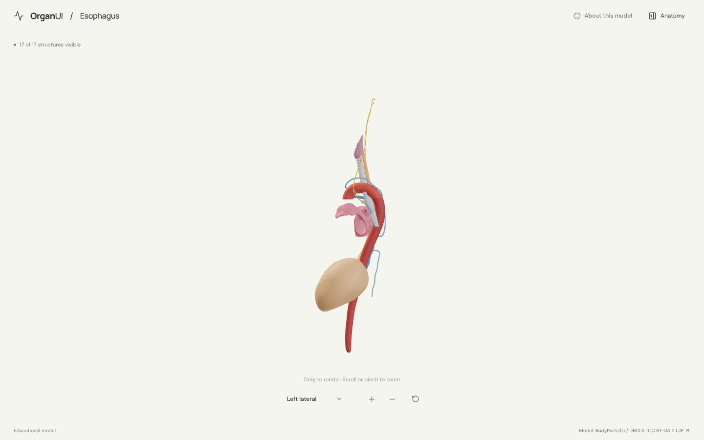
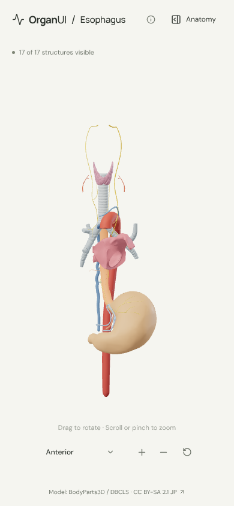

# OrganUI Esophagus

A minimal, standalone, open-source esophagus anatomy explorer built with React, TypeScript, Three.js, React Three Fiber, Vite, and Bun. It shares its interaction design and code with [OrganUI Heart](https://github.com/organui/heart-3d).

**Status:** working local demo. Seventeen selectable structures from a real, openly licensed model, responsive layouts, and checked desktop/mobile interactions. Public deployment and clinical anatomy review have not been completed.



## Run locally

Install [Bun](https://bun.sh/) **1.4.2 or newer**, then:

```sh
git clone https://github.com/organui/esophagus-3d.git
cd esophagus-3d
bun install --frozen-lockfile
bun run dev
```

Open **http://127.0.0.1:5173**. No environment variables, accounts, API keys, sibling repositories, model downloads, or external font services are needed after dependency installation. The ready-to-use 4.0 MB GLB is in `public/models/`.

```sh
bun run typecheck       # TypeScript checks, including conversion scripts
bun run test            # Unit tests for selection emphasis, picking, ownership, and the anatomy-tree adapter
bun run verify:model    # Check the GLB hash, source IDs, element lists, and valid geometry
bun run build           # Typecheck and create dist/
bun run preview         # Serve the production build at http://127.0.0.1:4173
bun run format:check    # Check formatting
```

The app is static and uses relative build paths. No deployment has been performed.

## Explore

- The esophagus opens in the anterior view with the trachea, heart, stomach and the vessels and nerves beside it. Open **Anatomy** in the header to browse structures.
- Drag to rotate; scroll or pinch to zoom. The view menu has anterior, posterior and left lateral presets. Manual rotation changes its label to **Custom view**; zooming and selecting keep the view name.
- Select a mesh or use the anatomy tree (the OrganUI registry `anatomy-tree` component, see [registry integration](docs/REGISTRY_INTEGRATION.md)). The selected structure glows in its own colour and everything else is ghosted, so the esophagus stays visible behind the trachea and heart.
- Isolate a structure, hide it, or restore all. **Reset explorer** restores the anterior camera, visibility, selection, tree state and tour.
- Follow five guided stops: the whole tube, the trachea in front of it, the narrowings made by the aortic arch and left bronchus, the left atrium, and the stomach.
- Keyboard: Tab/Enter for controls, arrow keys to rotate the focused model, `+`/`-` to zoom, Escape closes the panel and returns focus to its toggle.

<details>
<summary>Selection, posterior view and mobile screenshots</summary>







</details>

## Model, credits, and license

> BodyParts3D / Anatomography, © The Database Center for Life Science (DBCLS), licensed under Creative Commons Attribution-Share Alike 2.1 Japan. Adapted by OrganUI.

The model is a curated subset of **BodyParts3D / Anatomography 4.3**: 24 source meshes grouped into 17 structures. The model data and screenshots of it are under **[CC BY-SA 2.1 Japan](https://creativecommons.org/licenses/by-sa/2.1/jp/deed.en)**, separately from this repository's **MIT code license**. Meshes come from a checksum-pinned public mirror and are cross-checked against the official 4.3 concept table. Read [model provenance](docs/MODEL_PROVENANCE.md), [asset attribution](public/models/ATTRIBUTION.md) and the [manifest](public/models/manifest.json).

Descriptions summarise general anatomy. **Expert anatomical review is pending.** This is an educational interface demonstration, not a diagnostic or clinical tool.

Known limitations:

- The esophagus is one coarse mesh. Its cervical, thoracic and abdominal parts and its sphincters cannot be selected separately.
- The diaphragm is omitted because it hid the lower esophagus and stomach from every view; the hiatus is described in text. The pharynx, larynx, lungs, the rest of the heart and smaller vessels are also omitted. The vagus nerves are shown as full trunks, so they extend above the esophagus.
- Several small arteries, veins and nerves are grouped into one selectable set each. Colours are illustrative.
- Browser checks used headless Chromium with software WebGL at desktop and phone viewport sizes, not physical devices or a screen-reader audit.

## License

Original application code: [MIT](LICENSE). Anatomy model, derived model images, fonts, and icons retain their separately documented licenses.

Part of [OrganUI](https://github.com/organui).
